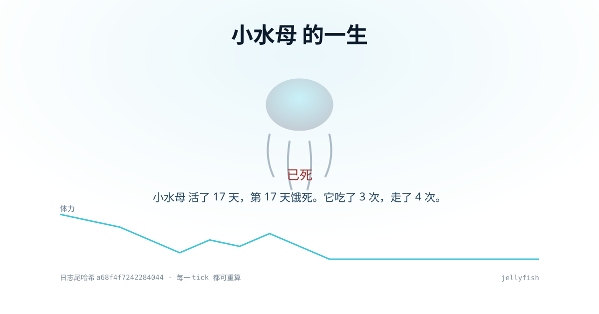

# jellyfish 🪼


**一只有寿命的水母。它的一生是一条可以倒回去重放的日志。**

> A jellyfish you can starve to death — then rewind its entire life.

```bash
python jellyfish.py serve        # → http://127.0.0.1:8080
# 想复现别人的那一只？网址里带上种子：http://127.0.0.1:8080/?seed=42
```

零依赖、零凭证、零网络。**单文件，复制走就能跑。**



上面这张图是 `python jellyfish.py card --out card.svg` 生成的 —— **一条命令，零依赖，不需要浏览器截图**。
卡片上带日志尾哈希，可以对回它的一生。

## 不想 clone？一行就能跑

```bash
curl -s https://raw.githubusercontent.com/hansei996/jellyfish/main/jellyfish.py | python - tick --times 30
```

实测（从 GitHub raw 拉 35 KB 直接喂给 python）：

```text
{"tick": 30, "energy": 0, "alive": false, "death_reason": "饿死：第 30 个 tick 能量归零", ...}
```

想看点得见的：先把文件存下来再 serve。

```bash
curl -sO https://raw.githubusercontent.com/hansei996/jellyfish/main/jellyfish.py
python jellyfish.py serve
```
## 屏幕上是什么

```text
        .-~~~~~-.            ← 伞盖随体力缩放：饿了会瘪
      /           \
     |   一只水母   |         小水母 活了 10 天，第 10 天饿死。
      \           /          它吃了 3 次，走了 4 次。
       '-._____.-'
        | | | | |            ← 触须；死后变灰下沉

  [过一天] [过五天] [救活它]
```

下面是一张时间轴：每天它**看到什么 / 决定什么 / 为什么 / 体力剩多少**。

## 四种性格，寿命不一样（实测中位寿命）

| policy | 中位寿命 | 最短/最长 | 性格 |
|---|---|---|---|
| `balanced` | 12 天 | 5 / 46 | 该吃吃该走走 |
| `frugal` | 13 天 | 7 / 25 | 省着用，几乎不动 |
| `adventurous` | 4 天 | 4 / 12 | 宁可多走，赌下一格有吃的 |
| `opportunist` | 22 天 | 7 / 84 | 低位补仓，能囤就囤 |

（数字来自 `python examples/03_compare.py`，40 个种子；改一行代码就会变，所以不手抄。）

```bash
python jellyfish.py tick --root demo --name 阿水 --policy opportunist --times 40
python jellyfish.py export --root demo --out life.html   # 单文件传记，双击就开
python jellyfish.py card   --root demo --out card.svg    # 1200x630 分享卡，可直接贴出去
python jellyfish.py movie  --root demo --out demo.svg    # 会动的 SVG（GIF 的零依赖替代）
```

## 它凭什么可信

| 特性 | 怎么做到 |
|---|---|
| 决定论重放 | `step()` 是纯函数，随机值写进日志；同一份日志永远重放同一只水母 |
| 会死 | 体力归零即饿死；**四种性格都会死**（有测试） |
| 可审计 | 每步记录观测/决策/理由/状态哈希；日志是 sha256 链，改一个字节立刻报错 |
| 可分享 | `export` 出单文件 HTML，不联网也能看 |

## 换成你自己的水母

完整三步走见 [`docs/EXTEND.md`](./docs/EXTEND.md)，可运行示例在 [`examples/`](./examples/)。

改 `jellyfish/core.py` 里两个函数：

```python
def default_world(tick, seed=0):      # 它看到什么：天气、股价、你的 commit 数
def decide_with(state, world, roll, policy):   # 它怎么决定：LLM / 规则 / RL
```

也可以**不改库**，直接传一个函数进去：

```python
def gambler(state, world, roll):
    if world.get("food") and roll < 0.15:
        return {"action": "eat", "reason": "赌徒：手气到了"}
    return {"action": "move", "reason": "赌徒：下一格更好"}

state, record = step(state, world, roll, gambler)
```

实测这只赌徒只能活 4 天（中位）——它在有吃的 85% 的时候选择继续走。
只要保持纯函数，**你的水母也能被完整重放**。

## 开发

```bash
python -m pytest tests -q        # 39 passed，全部离线
python tools/build_single.py     # 重新生成 jellyfish.py（CI 会校验它没被手改）
python tools/preflight.py        # 推送前的四道闸门（我自己两次带着红测试推过，所以做成了脚本）
```

克隆仓库后也可以直接用包跑（不用单文件）：

```bash
python -m jellyfish tick --root demo --policy opportunist --times 30
```

## English

A jellyfish with a lifespan: it forages, starves, dies. Every decision is a pure function of an
append-only hash-chained log, so its whole life replays byte-for-byte. Swap `decide_with()` or
`default_world()` and it becomes your creature — still replayable. Pure stdlib, single file, no keys.